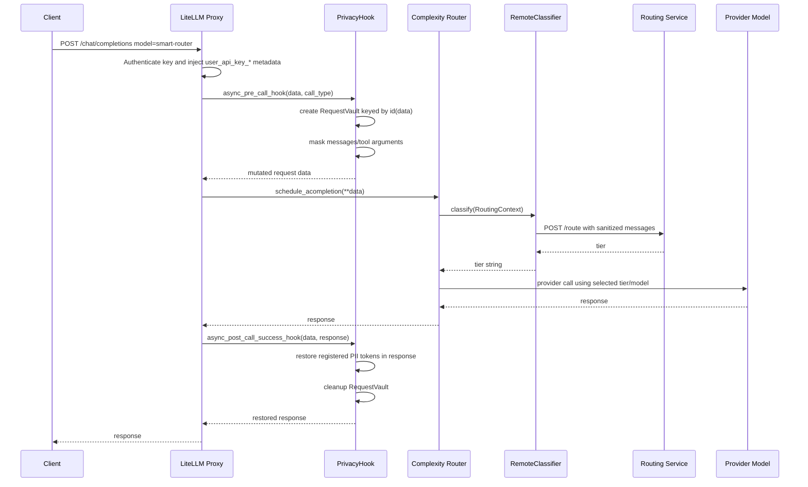
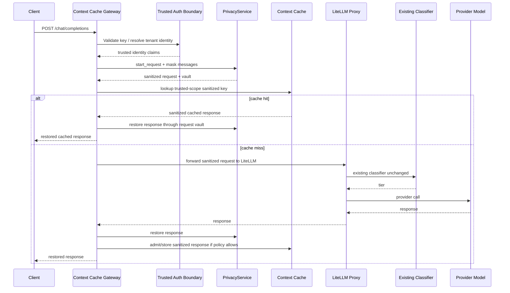

# Context Cache Design Discovery

Date: 2026-11-09

Scope: repository discovery and feasibility for a future context cache. This phase does not implement a cache and does not modify classifier, routing, privacy, tier, alias, or endpoint behavior.

## Executive Finding

LiteLLM 1.103.2 provides a supported `CustomLogger.async_pre_call_hook` extension point that can inspect and mutate the request before the complexity-router classifier runs. The current privacy hook already uses that point, so the classifier sees sanitized messages.

However, the same supported hook cannot return a completed cache response and skip the classifier/provider. In LiteLLM 1.103.2, `ProxyLogging.process_pre_call_hook_response()` accepts only:

- `Exception`: raised.
- `dict`: treated as the mutated request data.
- `str`: rejected as a bad request / rejected request.
- anything else: ignored in favor of the original data.

Therefore a safe Phase 1 cache cannot live entirely inside a new proxy callback while keeping the classifier untouched and avoiding undocumented internals. The smallest safe integration point is a separate gateway/adapter in front of LiteLLM:

1. Gateway authenticates or receives already-authenticated identity from a trusted server boundary.
2. Gateway calls the same privacy layer to sanitize the request.
3. Gateway checks context cache using a tenant/user-scoped key over sanitized content.
4. On hit, gateway restores cached sanitized response through the per-request vault and returns without calling LiteLLM.
5. On miss, gateway forwards the sanitized request to LiteLLM, where the existing classifier and providers run unchanged.
6. Gateway restores the response, evaluates admission, stores sanitized cache material, and returns restored output.

## Files Inspected

Repository files:

- `config.yaml`
- `docker-compose.quickstart.yml`
- `Dockerfile.litellm`
- `privacy-requirements.txt`
- `requirements-dev.txt`
- `plugins/privacy_hook.py`
- `plugins/remote_classifier.py`
- `privacy/__init__.py`
- `privacy/service.py`
- `privacy/detector.py`
- `privacy/masker.py`
- `privacy/response_restorer.py`
- `privacy/token_vault.py`
- `privacy/policy.py`
- `privacy/policies.yaml`
- `routing-service/app.py`
- `routing-service/Dockerfile`
- `routing-service/requirements.txt`
- `tests/privacy/test_privacy_layer.py`

Pinned LiteLLM image/source inspected from `litellm-router-privacy:v1.103.2`:

- `/app/.venv/lib/python3.13/site-packages/litellm/integrations/custom_logger.py`
- `/app/.venv/lib/python3.13/site-packages/litellm/proxy/utils.py`
- `/app/.venv/lib/python3.13/site-packages/litellm/proxy/common_request_processing.py`
- `/app/.venv/lib/python3.13/site-packages/litellm/proxy/litellm_pre_call_utils.py`
- `/app/.venv/lib/python3.13/site-packages/litellm/proxy/proxy_server.py`
- `/app/.venv/lib/python3.13/site-packages/litellm/router_strategy/complexity_router/complexity_router.py`
- `/app/.venv/lib/python3.13/site-packages/litellm/router_strategy/complexity_router/config.py`

## Current Repository Structure

The stack has three active parts:

- LiteLLM proxy container built from `Dockerfile.litellm`, pinned to `docker.litellm.ai/berriai/litellm:v1.103.2`.
- Read-only mounted plugins and privacy package under `/app/plugins` and `/app/privacy`.
- Separate `routing-service` FastAPI container used by the LiteLLM custom complexity-router classifier.

`config.yaml` sets:

- `litellm_settings.callbacks: plugins.privacy_hook.privacy_hook`
- `model_name: smart-router`
- `model: auto_router/complexity_router`
- `classifier_type: custom`
- `classifier_plugin: plugins.remote_classifier.remote_classifier`
- tiers `SIMPLE`, `MEDIUM`, `COMPLEX`, `REASONING`
- default model `local-llama`

`docker-compose.quickstart.yml` sets:

- image `litellm-router-privacy:v1.103.2`
- `ROUTER_SERVICE_URL=http://routing-service:8000/route`
- `PRIVACY_LAYER_ENABLED=true` by default
- `PRIVACY_POLICY_PATH=/app/privacy/policies.yaml`
- read-only mounts for `plugins` and `privacy`
- `routing-service` health check and port `8000:8000`

## Protected Files

These files are protected for this roadmap and must remain unchanged unless a later approved phase explicitly allows it:

- `plugins/remote_classifier.py`
- `routing-service/app.py`
- `routing-service/examples.json`
- `routing-service/Dockerfile`
- `routing-service/requirements.txt`
- `config.yaml`, for routing tiers, aliases, endpoint contract, classifier configuration, and model/provider routing fields
- `plugins/privacy_hook.py`, because it is the existing privacy enforcement boundary
- `privacy/**`, because it is the implemented privacy engine
- `docker-compose.quickstart.yml`, for launch contract, service topology, and mounted plugin/privacy paths

## Current Request/Response Lifecycle



Lifecycle notes:

- `plugins/privacy_hook.py` rejects unsupported call types and streaming when policy requires it.
- `PrivacyService.start_request()` creates an in-memory `RequestVault`.
- `PrivacyMasker.mask_request_messages()` deep-copies messages, tokenizes restorable PII, and redacts non-restorable secrets.
- `RemoteClassifier.classify()` sends `context.structured_messages` or `context.raw_messages` to `ROUTER_SERVICE_URL`.
- `routing-service/app.py` classifies latest user text by rules, embeddings, local LLM, then fallback.
- `ResponseRestorer.restore_response()` restores only registered tokens in message content and tool-call arguments.
- Privacy cleanup runs on success and failure hooks.

## LiteLLM 1.103.2 Hook Feasibility

Verified signatures from the pinned image:

```text
CustomLogger.async_pre_call_hook(self, user_api_key_dict, cache, data: dict, call_type) -> Exception | str | dict | None
CustomLogger.async_post_call_success_hook(self, data: dict, user_api_key_dict, response) -> Any
CustomLogger.async_post_call_failure_hook(self, request_data: dict, original_exception, user_api_key_dict, traceback_str=None) -> Optional[HTTPException]
```

Verified execution order:

- `common_request_processing.py` initializes logging, merges model guardrails, then calls `proxy_logging_obj.pre_call_hook(...)`.
- After the pre-call hook, LiteLLM refreshes its request snapshot and logging messages.
- The request is then routed with `router.schedule_acompletion(**data)`.
- The complexity router builds `RoutingContext` from `raw_messages`, resolved `structured_messages`, candidate models, and metadata, then awaits `plugin.classify(context)`.
- Post-call success hooks can return a replacement response, and the proxy uses it.

Feasibility checklist:

| Requirement | Supported in LiteLLM proxy hook? | Evidence / result |
| --- | --- | --- |
| Receive sanitized request before classifier | Yes | Existing `PrivacyHook.async_pre_call_hook()` runs before `router.schedule_acompletion`; classifier receives messages from the mutated request data. |
| Return cache response before classifier/provider | No | `process_pre_call_hook_response()` treats a dict as request data, a string/exception as rejection, and does not support returning `ModelResponse`. |
| Maintain per-request state safely | Partially | Current privacy hook uses `id(data)` as a request key and cleans it up in success/failure hooks. This is workable inside the existing lifecycle, but a cache gateway should use explicit request context rather than object identity. |
| Inspect response for admission | Yes | `async_post_call_success_hook()` receives data and response and may return a modified response. |

Because pre-call short-circuit is not supported, an in-proxy context-cache callback would have to rely on monkey-patching, undocumented globals, endpoint rewrites, or classifier edits. Those are outside the constraints.

## Tenant/User Identity Boundary

Trusted identity should come from LiteLLM-authenticated key metadata, not from client-supplied request fields.

LiteLLM source shows request metadata sanitization strips client-provided `user_api_key_*` fields before the proxy injects server-derived values from `UserAPIKeyAuth`, including:

- `user_api_key_user_id`
- `user_api_key_team_id`
- `user_api_key_alias`
- `user_api_key_hash`
- `user_api_key_org_id`
- `user_api_key_project_id`
- `user_api_key_end_user_id`

For a gateway, the safest options are:

- Put the gateway behind LiteLLM only if LiteLLM remains the authenticator and forwards signed/server-only identity to the gateway.
- Or put the gateway in front only if it validates the same LiteLLM virtual key / master-key contract itself or calls a trusted auth validation service.

Do not trust:

- request body `metadata.user_id`
- request body `metadata.user_api_key_*`
- arbitrary headers like `x-user-id`, unless added and signed by a trusted upstream.

Recommended cache namespace:

```text
tenant_scope = authenticated team/org/project id if present, else authenticated user id, else authenticated key hash
cache_key = hash(versioned_policy_id, tenant_scope, model alias, normalized sanitized messages, relevant generation params)
```

## Proposed Gateway Architecture



Smallest safe integration point:

- A thin HTTP adapter preserving OpenAI-compatible `/v1/chat/completions` semantics.
- Reuse `privacy.service.PrivacyService` rather than duplicating masking/restoration.
- Forward only sanitized payloads to existing LiteLLM.
- Keep `plugins/remote_classifier.py`, `routing-service/**`, `config.yaml` routing fields, and existing privacy files unchanged.

## Phase 1 Dependencies/Files Only

Phase 1 should be limited to new files plus optional Compose wiring. It should not modify protected files unless explicitly approved.

Candidate new files:

- `context-cache-gateway/app.py`
- `context-cache-gateway/cache.py`
- `context-cache-gateway/auth.py`
- `context-cache-gateway/keying.py`
- `context-cache-gateway/admission.py`
- `context-cache-gateway/requirements.txt`
- `context-cache-gateway/Dockerfile`
- `tests/context_cache_gateway/test_keying.py`
- `tests/context_cache_gateway/test_privacy_gateway_flow.py`

Potential optional wiring file:

- A new compose overlay such as `docker-compose.context-cache.yml`, instead of changing `docker-compose.quickstart.yml`.

Dependencies to consider:

- `fastapi`
- `uvicorn[standard]`
- `httpx`
- `pydantic`
- `PyYAML`
- cache backend client chosen later, for example Redis, SQLite, or Postgres

Phase 1 should prove:

- Authentication/identity is trusted before cache lookup.
- Cache keys are scoped by authenticated tenant/user identity.
- Cache lookup happens after privacy masking and before LiteLLM.
- Cache hits do not call LiteLLM, classifier, routing service, Ollama, or OpenAI.
- Cache misses preserve the current classifier/provider lifecycle.
- Only sanitized prompts/responses are stored.
- Restored content is never stored as cache material.

## Stop Condition

The prompt required stopping if no supported LiteLLM hook can short-circuit before classifier/provider while keeping the classifier untouched. That condition is met.

Recommendation: stop here and get approval before implementing a separate context-cache gateway/adapter.

## Protected File Status

No protected source/config files were changed during this discovery. The only repository artifact created by this phase is this document, `CONTEXT_CACHE_DESIGN.md`.
