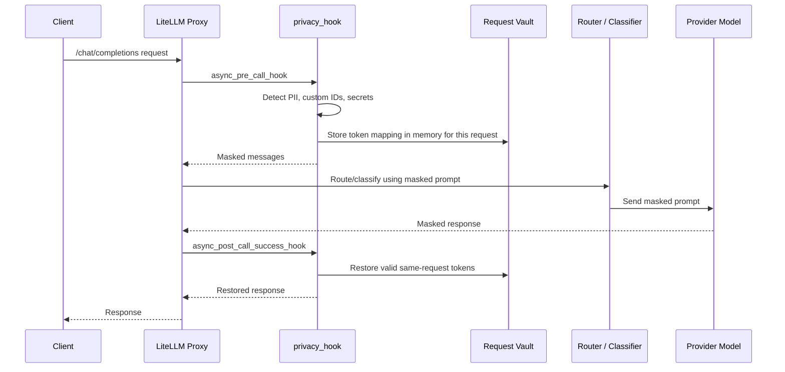

# Privacy Layer

## Overview

This project now includes a reversible, request-scoped privacy layer for LiteLLM Proxy. It masks configured sensitive values before the LiteLLM router, classifier, routing service, Ollama model, or OpenAI provider sees the prompt, then restores approved placeholders in the non-streaming chat response returned to the client.

The privacy layer is implemented separately from the existing classifier and routing service:

```text
privacy/
  policy.py
  detector.py
  masker.py
  token_vault.py
  response_restorer.py
  service.py
  policies.yaml
plugins/
  privacy_hook.py
```

The existing classifier plugin and routing service files are intentionally unchanged.

## Request Flow



## LiteLLM 1.103.2 Compatibility

The integration uses LiteLLM Proxy `CustomLogger` hooks:

- `async_pre_call_hook(user_api_key_dict, cache, data, call_type)`
- `async_post_call_success_hook(data, user_api_key_dict, response)`
- `async_post_call_failure_hook(...)`

The verified LiteLLM 1.103.2 request path runs `proxy_logging_obj.pre_call_hook(...)` before `route_request(...)`, so masked messages are applied before the auto-router invokes the custom classifier. Streaming is rejected while privacy protection is enabled because safe restoration across split chunks is not implemented.

## Configuration

### Enable or Disable

The privacy layer is enabled by default:

```env
PRIVACY_LAYER_ENABLED=true
```

Set it to `false` only if you intentionally want to bypass masking.

### Policy File

The proxy container reads:

```env
PRIVACY_POLICY_PATH=/app/privacy/policies.yaml
```

Edit [`privacy/policies.yaml`](privacy/policies.yaml) to configure:

- enabled entities
- score thresholds
- reversible tokenization vs redaction
- custom regex templates
- streaming rejection
- fail-closed behavior

Policy changes require a proxy restart.

## Custom Templates

Example custom pattern:

```yaml
custom_patterns:
  - name: customer_id
    entity_type: CUSTOMER_ID
    regex: "\\bCUST-[0-9]{6}\\b"
    score: 0.95
    action: tokenize
    restore: true
```

Use `action: redact` and `restore: false` for secrets or credentials.

## Masking Example

Input:

```text
Email alice@example.com about CUST-123456. Use sk-example-secret-token-value.
```

Provider/classifier sees:

```text
Email [[PII_EMAIL_ADDRESS_<random>]] about [[PII_CUSTOMER_ID_<random>]]. Use [[REDACTED_SECRET]].
```

The response restorer only replaces valid tokens created for the current request. Redacted secrets are never restored.

## Dependencies

The LiteLLM proxy image is built from [`Dockerfile.litellm`](Dockerfile.litellm), which pins:

```dockerfile
FROM docker.litellm.ai/berriai/litellm:v1.103.2
```

Privacy dependencies are listed in [`privacy-requirements.txt`](privacy-requirements.txt):

- `presidio-analyzer`
- `presidio-anonymizer`
- `PyYAML`

`presidio-analyzer` currently installs spaCy as a transitive dependency, but this implementation configures Presidio with its `NoOpNlpEngine` by default. During verification, the pinned LiteLLM `v1.103.2` image's Python 3.13 runtime raised a spaCy tokenizer `OverflowError` when loading `en_core_web_sm`, so the default policy keeps PERSON and LOCATION NER disabled. Enable those entities only after validating a compatible NLP engine/runtime in your deployment image.

For local development on Windows:

```powershell
python -m venv .venv
.\.venv\Scripts\Activate.ps1
python -m pip install --upgrade pip
python -m pip install -r privacy-requirements.txt
python -m pip install -r requirements-dev.txt
```

## Docker Usage

Rebuild and start:

```powershell
docker compose -f docker-compose.quickstart.yml up -d --build
```

The Compose file mounts:

- `./plugins:/app/plugins:ro`
- `./privacy:/app/privacy:ro`
- `./config.yaml:/app/config.yaml`

## Supported Scope

Supported:

- OpenAI-compatible non-streaming chat completions through LiteLLM Proxy.
- Text content in chat messages.
- Text blocks shaped like `{"type": "text", "text": "..."}`.
- Tool call `function.arguments` strings in chat messages and responses.
- Non-streaming chat response message content and tool-call argument restoration.

Rejected or unsupported while privacy is enabled:

- Streaming chat completions.
- Embeddings.
- Image, audio, files, batch, vector store, and passthrough endpoints.
- Multimodal image/audio payload inspection.

## Logging and Retention

The integration updates [`config.yaml`](config.yaml) with:

```yaml
general_settings:
  store_prompts_in_spend_logs: false
litellm_settings:
  turn_off_message_logging: true
  redact_user_api_key_info: true
```

This is required because LiteLLM post-call hooks run before deferred success logging is flushed. Without message/response logging disabled, restored response content could be captured by logging callbacks. The privacy hook logs only metadata such as entity types and counts, never raw values, mappings, or token strings.

## Threat Model and Limitations

- PII detection is probabilistic and can miss sensitive values.
- Person and location NER are disabled in the default policy because the pinned LiteLLM 1.103.2 image failed spaCy model loading under Python 3.13 during verification.
- Presidio and local patterns still cover structured entities such as email addresses, phone numbers, dates, configured IDs, and secret patterns.
- Regex templates only detect values matching configured patterns.
- Secrets default to redaction and are not restored.
- Mappings are in-memory, per-process, request-scoped, and not persisted.
- If the proxy runs multiple worker processes, each request must complete in the same worker that created its mapping. The current Docker command does not configure multiple workers.
- The privacy layer does not claim regulatory compliance.

## Tests

Run:

```powershell
python -m unittest discover -s tests -t . -p "test_*.py"
```

In a full dev environment with pytest installed, the same tests can be run with:

```powershell
python -m pytest tests
```

The tests use synthetic data only and cover:

- email and phone masking
- custom customer and employee IDs
- repeated and distinct values
- Unicode, punctuation, newlines, and adjacent spans
- token collision avoidance
- same-request-only restoration
- forged token rejection
- secret redaction
- concurrent request isolation
- detector failure behavior
- response restoration
- streaming rejection policy

## Smoke Test

After rebuilding the stack, send a non-streaming chat request containing synthetic data:

```powershell
curl http://localhost:4000/v1/chat/completions `
  -H "Authorization: Bearer $env:LITELLM_MASTER_KEY" `
  -H "Content-Type: application/json" `
  -d '{ "model": "smart-router", "messages": [{"role":"user","content":"Email alice@example.com about CUST-123456"}] }'
```

Check LiteLLM and routing-service logs for safe metadata only. Do not use real personal data or real credentials in smoke tests.
