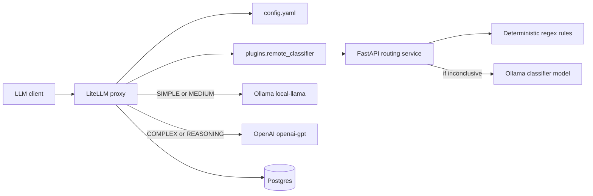
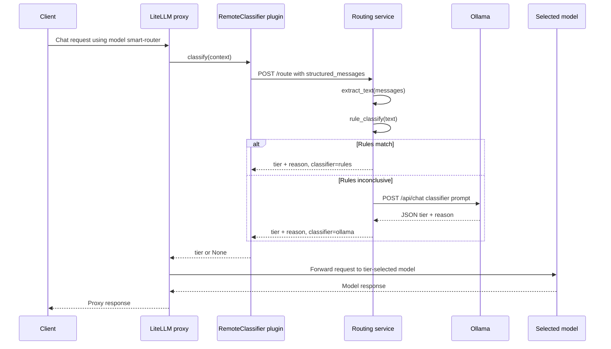

# LiteLLM Router Project Documentation

## 1. Project Overview

### Project name

LiteLLM Router

### Purpose

This project defines a local LiteLLM proxy stack that routes chat requests between a local Ollama model and an OpenAI-backed model by using a custom complexity classifier.

The repository contains:

- A LiteLLM proxy configuration in [`config.yaml`](config.yaml).
- A Docker Compose quickstart stack in [`docker-compose.quickstart.yml`](docker-compose.quickstart.yml).
- A custom LiteLLM classifier plugin in [`plugins/remote_classifier.py`](plugins/remote_classifier.py).
- A FastAPI routing sidecar in [`routing-service/app.py`](routing-service/app.py) that classifies prompts into routing tiers.
- A local environment file, [`.env`](.env), whose values are intentionally not documented here.

### Problem it solves

LiteLLM can proxy requests to multiple model providers. This project adds an additional routing decision before model selection:

- Simple and medium requests are routed to a local Ollama model.
- Complex and reasoning-heavy requests are routed to an OpenAI model.
- The classification decision is made by deterministic rules first, then by an Ollama classifier model when the rules are inconclusive.

The intended outcome is cost-conscious and capability-aware routing: easy prompts stay local, while harder prompts can use a more capable remote model.

### Main objectives

- Run LiteLLM, Postgres, and a prompt routing service with Docker Compose.
- Expose a single LiteLLM model alias named `smart-router`.
- Use LiteLLM's `auto_router/complexity_router` with a custom classifier plugin.
- Keep the classifier logic outside the LiteLLM container by calling a separate FastAPI service.
- Fall back gracefully when the external classifier is unavailable.

### Key features

- Dockerized LiteLLM gateway on port `4000` by default.
- Dockerized Postgres database for LiteLLM persistence.
- Dockerized FastAPI classification service on port `8000`.
- Rule-based classification for clearly simple, coding, debugging, and advanced reasoning prompts.
- Ollama-backed JSON classifier for prompts not matched by rules.
- LiteLLM plugin that calls the routing service and returns one of four tiers:
  `SIMPLE`, `MEDIUM`, `COMPLEX`, or `REASONING`.

### Intended users and use cases

The project appears intended for developers evaluating or running a local LiteLLM smart-routing setup. It is especially relevant when a team wants to:

- Use a local model for low-cost or offline-friendly requests.
- Escalate harder requests to a stronger hosted model.
- Experiment with custom LiteLLM routing logic.
- Keep classification behavior observable and independently deployable.

## 2. Technology Stack

| Technology | Evidence | Role in this project |
| --- | --- | --- |
| Python 3.11 | [`routing-service/Dockerfile`](routing-service/Dockerfile) uses `python:3.11-slim`. | Runtime for the FastAPI routing service. |
| FastAPI | [`routing-service/requirements.txt`](routing-service/requirements.txt), [`routing-service/app.py`](routing-service/app.py). | Defines `/health` and `/route` HTTP endpoints. |
| Uvicorn | [`routing-service/requirements.txt`](routing-service/requirements.txt), Docker `CMD`. | ASGI server for the FastAPI app. |
| Pydantic | Imported in [`routing-service/app.py`](routing-service/app.py). | Request and response validation models. |
| httpx | Used in [`routing-service/app.py`](routing-service/app.py) and [`plugins/remote_classifier.py`](plugins/remote_classifier.py). | Async HTTP client for calling Ollama and the routing service. |
| LiteLLM proxy | [`docker-compose.quickstart.yml`](docker-compose.quickstart.yml), [`config.yaml`](config.yaml). | Main LLM gateway and smart router. |
| LiteLLM custom classifier plugin | [`config.yaml`](config.yaml), [`plugins/remote_classifier.py`](plugins/remote_classifier.py). | Allows LiteLLM's complexity router to delegate tier selection to project-owned Python code. |
| Ollama | [`config.yaml`](config.yaml), [`routing-service/app.py`](routing-service/app.py), Compose environment. | Hosts the local model and the classifier model at `host.docker.internal:11434`. |
| OpenAI integration | [`config.yaml`](config.yaml), Compose `OPENAI_API_KEY`. | Provides the configured remote model alias `openai-gpt`. |
| Postgres 16 | [`docker-compose.quickstart.yml`](docker-compose.quickstart.yml). | LiteLLM database for models, virtual keys, and spend logs. |
| Docker and Docker Compose | [`docker-compose.quickstart.yml`](docker-compose.quickstart.yml), [`routing-service/Dockerfile`](routing-service/Dockerfile). | Packaging and local orchestration. |

No test framework, CI/CD workflow, frontend framework, migration system, or explicit Python package metadata file is present in the repository.

## 3. Project Directory Structure

```text
litellm-router/
|-- .env
|-- config.yaml
|-- docker-compose.quickstart.yml
|-- plugins/
|   |-- __init__.py
|   `-- remote_classifier.py
`-- routing-service/
    |-- Dockerfile
    |-- app.py
    `-- requirements.txt
```

### Directory purposes

| Path | Purpose |
| --- | --- |
| `.` | Root deployment and LiteLLM configuration directory. Compose reads `.env` from here. |
| `plugins/` | Python package mounted into the LiteLLM container. Contains the custom classifier plugin referenced by LiteLLM config. |
| `routing-service/` | Standalone FastAPI classifier service build context. Contains runtime code, dependencies, and Dockerfile. |

## 4. Detailed File-by-File Explanation

### `.env`

**Purpose:** Provides local environment variables consumed by Docker Compose.

**Responsibilities:**

- Supplies LiteLLM secret material.
- Supplies the OpenAI API key used by the configured OpenAI model.

**Identified variables:**

- `LITELLM_MASTER_KEY`
- `LITELLM_SALT_KEY`
- `OPENAI_API_KEY`

The actual values are intentionally omitted from this documentation.

**Inputs:** Manually managed environment variable values.

**Outputs and side effects:** Docker Compose interpolates these values into service environment variables.

**Dependencies and interactions:**

- Read automatically by Docker Compose when running [`docker-compose.quickstart.yml`](docker-compose.quickstart.yml).
- `LITELLM_MASTER_KEY` and `LITELLM_SALT_KEY` are required by the `litellm` service.
- `OPENAI_API_KEY` is passed to the `litellm` service and referenced by [`config.yaml`](config.yaml).

**Execution:** Not executable. It is configuration consumed by Docker Compose.

**Important implementation details:**

- The Compose file warns that regenerating `LITELLM_SALT_KEY` can make existing stored credentials unreadable.
- No `.env.example` file is present, so onboarding relies on Compose comments and this documentation.

### `config.yaml`

**Purpose:** Configures LiteLLM models and the smart routing policy.

**Responsibilities:**

- Enables prompt storage in spend logs with `general_settings.store_prompts_in_spend_logs: true`.
- Defines the public model alias `smart-router`.
- Configures `smart-router` to use LiteLLM's `auto_router/complexity_router`.
- Connects the complexity router to the custom plugin at `plugins.remote_classifier.remote_classifier`.
- Defines routing tiers and target model aliases.
- Defines the OpenAI-backed model alias `openai-gpt`.
- Defines the Ollama-backed model alias `local-llama`.

**Key configuration:**

| Setting | Value | Effect |
| --- | --- | --- |
| `store_prompts_in_spend_logs` | `true` | LiteLLM is configured to store prompts in spend logs. This has privacy and retention implications. |
| `model_name: smart-router` | Public model alias | Clients can request this model through LiteLLM. |
| `model: auto_router/complexity_router` | LiteLLM router model | Enables tier-based model selection. |
| `classifier_type` | `custom` | Tells LiteLLM to use a custom classifier plugin. |
| `classifier_plugin` | `plugins.remote_classifier.remote_classifier` | Imports the plugin object from this repository. |
| `classifier_plugin_timeout_ms` | `10000` | Allows up to 10 seconds for plugin classification. |
| `default_model` | `local-llama` | Fallback model configured for the router. |
| `openai-gpt` | `openai/gpt-5.6` | Remote model alias configured through LiteLLM. This documentation does not verify provider availability of that model name. |
| `local-llama` | `ollama/qwen3.5:0.8b` | Local model alias served through Ollama. |

**Tier mapping:**

| Tier | Target model alias |
| --- | --- |
| `SIMPLE` | `local-llama` |
| `MEDIUM` | `local-llama` |
| `COMPLEX` | `openai-gpt` |
| `REASONING` | `openai-gpt` |

**Inputs:**

- LiteLLM proxy startup reads this file via the `--config /app/config.yaml` command in Compose.
- `OPENAI_API_KEY` is resolved through `api_key: os.environ/OPENAI_API_KEY`.

**Outputs and side effects:**

- Determines model availability and routing behavior for LiteLLM clients.
- Enables prompt storage in LiteLLM spend logs.

**Dependencies:**

- LiteLLM support for `auto_router/complexity_router`.
- The Python module mounted at `/app/plugins`.
- Ollama endpoint reachable from the LiteLLM container.
- OpenAI-compatible credentials supplied through `OPENAI_API_KEY`.

**Interactions:**

- The `litellm` service mounts this file into `/app/config.yaml`.
- The `classifier_plugin` imports [`plugins/remote_classifier.py`](plugins/remote_classifier.py).
- The plugin calls the routing service, which returns a tier used by this mapping.

**Execution:** Loaded by the LiteLLM proxy at container startup.

### `docker-compose.quickstart.yml`

**Purpose:** Defines the local multi-container runtime stack.

**Responsibilities:**

- Runs LiteLLM proxy.
- Runs Postgres for LiteLLM data persistence.
- Builds and runs the FastAPI routing service.
- Mounts project-owned configuration and plugin code into the LiteLLM container.
- Configures health checks and service dependencies.

**Services:**

| Service | Image/build | Purpose |
| --- | --- | --- |
| `litellm` | `docker.litellm.ai/berriai/litellm:main-stable` | LiteLLM proxy gateway. |
| `db` | `postgres:16` | Postgres database for LiteLLM models, virtual keys, and spend logs. |
| `routing-service` | Builds `./routing-service` | FastAPI service that classifies prompts into routing tiers. |

**Important settings:**

- `litellm` publishes `${LITELLM_BIND:-}${LITELLM_PORT:-4000}:4000`.
- `litellm` receives `DATABASE_URL`, `LITELLM_MASTER_KEY`, `LITELLM_SALT_KEY`, `OPENAI_API_KEY`, `PYTHONPATH`, and `ROUTER_SERVICE_URL`.
- `litellm` mounts:
  - `./config.yaml:/app/config.yaml`
  - `./plugins:/app/plugins:ro`
- `litellm` starts with `--config /app/config.yaml`.
- `db` persists data in the named volume `postgres_data`.
- `routing-service` exposes port `8000`.
- `routing-service` sets:
  - `OLLAMA_URL=http://host.docker.internal:11434`
  - `OLLAMA_CLASSIFIER_MODEL=qwen3.5:0.8b`

**Inputs:**

- `.env` values.
- Docker images from registries.
- Local `config.yaml`, `plugins/`, and `routing-service/` files.
- Host Ollama service reachable through `host.docker.internal:11434`.

**Outputs and side effects:**

- Starts containers and creates the `postgres_data` Docker volume.
- Publishes local ports `4000` and `8000` unless overridden.
- Builds the routing-service image.

**Dependencies:**

- Docker Engine and Docker Compose.
- Network access for image pulls and dependency installation during image build.
- Host access to Ollama if local classification and local model inference are expected.

**Interactions:**

- `litellm` depends on healthy `db` and healthy `routing-service`.
- `routing-service` health is checked through `http://localhost:8000/health` inside its container.
- `litellm` calls `routing-service` through `http://routing-service:8000/route`.

**Execution:** Run with Docker Compose:

```bash
docker compose -f docker-compose.quickstart.yml up -d
```

### `plugins/__init__.py`

**Purpose:** Marks `plugins/` as a Python package.

**Responsibilities:** Enables import paths such as `plugins.remote_classifier`.

**Key components:** None. The file is empty.

**Inputs/outputs:** None.

**Dependencies:** Python import system.

**Interactions:**

- Required for the LiteLLM container to import `plugins.remote_classifier.remote_classifier` reliably when `/app` is on `PYTHONPATH`.

**Execution:** Imported implicitly by Python package loading.

### `plugins/remote_classifier.py`

**Purpose:** Implements the custom LiteLLM classifier plugin.

**Responsibilities:**

- Receives a LiteLLM classifier context object.
- Sends the structured messages to the external routing service.
- Validates the returned tier.
- Logs classifier decisions.
- Returns `None` when classification fails so LiteLLM can use its configured fallback behavior.

**Key components:**

#### `VALID_TIERS`

Set of allowed tier strings:

- `SIMPLE`
- `MEDIUM`
- `COMPLEX`
- `REASONING`

This must match the tiers configured in [`config.yaml`](config.yaml) and returned by [`routing-service/app.py`](routing-service/app.py).

#### `class RemoteClassifier`

Contains the plugin implementation expected by LiteLLM.

##### `async classify(self, context) -> str | None`

**Purpose:** Classifies an incoming LiteLLM request by delegating to the routing service.

**Inputs:**

- `context`: A LiteLLM-provided object expected to expose `structured_messages`.
- Environment variable `ROUTER_SERVICE_URL`.

**Processing steps:**

1. Reads `ROUTER_SERVICE_URL`, defaulting to `http://routing-service:8000/route`.
2. Creates an `httpx.AsyncClient` with a 10 second timeout.
3. Sends a POST request containing:
   - `messages: context.structured_messages`
   - `metadata: {}`
4. Raises for non-success HTTP status codes.
5. Parses the JSON response.
6. Reads `tier` from the response.
7. Returns `None` and logs a warning if the tier is not valid.
8. Logs tier, classifier source, and policy version on success.
9. Returns the valid tier string.

**Outputs:**

- A valid tier string when classification succeeds.
- `None` when the service fails, the response is invalid, or any exception occurs.

**Dependencies:**

- `httpx` for async HTTP calls.
- `logging` for observability.
- `os.getenv` for configuration.
- Routing service endpoint implemented in [`routing-service/app.py`](routing-service/app.py).

**Interactions:**

- Imported by LiteLLM because [`config.yaml`](config.yaml) references `plugins.remote_classifier.remote_classifier`.
- Calls `POST /route` on the routing service.
- Allows LiteLLM to fall back if it returns `None`.

**Important implementation details:**

- The exception handler catches all exceptions and logs a stack trace with `logger.exception`.
- The plugin does not pass request metadata beyond an empty object.
- The code assumes `context.structured_messages` matches the routing service's expected message format.

#### `remote_classifier = RemoteClassifier()`

Module-level plugin instance referenced by LiteLLM configuration.

**Execution:** Imported by the LiteLLM process at runtime. The `classify` method is called by LiteLLM's complexity router.

### `routing-service/Dockerfile`

**Purpose:** Builds the container image for the FastAPI routing service.

**Responsibilities:**

- Starts from `python:3.11-slim`.
- Sets `/app` as the working directory.
- Installs Python dependencies from `requirements.txt`.
- Copies `app.py`.
- Exposes port `8000`.
- Starts Uvicorn with the FastAPI app.

**Key instructions:**

```dockerfile
FROM python:3.11-slim
WORKDIR /app
COPY requirements.txt .
RUN pip install --no-cache-dir -r requirements.txt
COPY app.py .
EXPOSE 8000
CMD ["uvicorn", "app:app", "--host", "0.0.0.0", "--port", "8000"]
```

**Inputs:** `requirements.txt`, `app.py`, and network access to install Python packages during build.

**Outputs:** A Docker image that runs the routing service.

**Dependencies:** Docker and Python package indexes.

**Interactions:**

- Used by the `routing-service` service in [`docker-compose.quickstart.yml`](docker-compose.quickstart.yml).

**Execution:** Built by Docker Compose when starting the stack.

### `routing-service/requirements.txt`

**Purpose:** Lists Python dependencies for the routing service container.

**Dependencies:**

| Dependency | Role |
| --- | --- |
| `fastapi` | Web framework for HTTP endpoints and request/response models. |
| `uvicorn[standard]` | ASGI server and optional performance/runtime extras. |
| `httpx` | Async HTTP client for calling Ollama. |

**Important details:**

- Versions are not pinned, so builds may install newer dependency versions over time.
- This file is used only by [`routing-service/Dockerfile`](routing-service/Dockerfile).

### `routing-service/app.py`

**Purpose:** Implements the standalone routing classification API.

**Responsibilities:**

- Exposes health and classification endpoints.
- Extracts text from chat messages.
- Applies deterministic routing rules.
- Calls Ollama for classification when rules are inconclusive.
- Returns a normalized routing response to the LiteLLM plugin.
- Falls back to `SIMPLE` if the Ollama classifier fails.

**Key module constants:**

| Name | Source/default | Purpose |
| --- | --- | --- |
| `OLLAMA_URL` | Env `OLLAMA_URL`, default `http://host.docker.internal:11434` | Base URL for Ollama API calls. |
| `CLASSIFIER_MODEL` | Env `OLLAMA_CLASSIFIER_MODEL`, default `qwen3.5:0.8b` | Ollama model used for classification. |
| `VALID_TIERS` | Static set | Allowed classification tiers. |

**Key components:**

#### `app = FastAPI(title="Intelligent Routing Service")`

Creates the FastAPI application. The title is visible in FastAPI-generated metadata and docs if those docs are enabled.

#### `class RouteRequest(BaseModel)`

Request schema for `POST /route`.

Fields:

- `messages: list[dict]` - chat messages to classify.
- `metadata: dict = {}` - optional metadata currently accepted but not used by the classifier logic.

#### `class RouteResponse(BaseModel)`

Response schema for `POST /route`.

Fields:

- `tier: str` - selected routing tier.
- `reason: str` - short explanation.
- `classifier: str` - source of classification, such as `rules`, `ollama`, or `fallback`.
- `policy_version: str = "v1"` - static policy version.

#### `extract_text(messages: list[dict]) -> str`

**Purpose:** Converts chat messages into plain text for classification.

**Inputs:** A list of message dictionaries.

**Processing:**

- Reads each message's `content`.
- If content is a string, appends it.
- If content is a list, appends `text` values from items where `type == "text"`.
- Ignores non-string content and non-text structured items.

**Output:** A newline-joined string containing extracted text.

**Important behavior:** Image or non-text multimodal content is ignored.

#### `rule_classify(text: str)`

**Purpose:** Returns a confident classification using deterministic regular-expression rules.

**Inputs:** Extracted prompt text.

**Processing:**

- Lowercases the text.
- Checks advanced reasoning patterns first.
- Checks coding/debugging complexity patterns second.
- Checks simple question patterns third.
- Applies a length guard for simple patterns: simple matches are only accepted when normalized text is under 500 characters.

**Outputs:**

- `("REASONING", "Matched advanced reasoning pattern")` for advanced reasoning patterns.
- `("COMPLEX", "Matched advanced coding/debugging pattern")` for coding/debugging patterns.
- `("SIMPLE", "Matched straightforward question pattern")` for short straightforward questions.
- `None` when no rule is sufficiently confident.

**Important patterns:**

- Reasoning examples: `prove`, `theorem`, `derive`, `differential equation`, `time complexity`, `dynamic programming`.
- Coding/debugging examples: fenced code blocks, `debug`, `race condition`, `deadlock`, `stack trace`, `refactor`, `segmentation fault`.
- Simple examples: prompts starting with `what is`, `define`, `who is`, `when did`, or containing `capital of`.

#### `async llm_classify(text: str)`

**Purpose:** Uses Ollama to classify prompts not handled by deterministic rules.

**Inputs:**

- Extracted prompt text.
- `OLLAMA_URL`.
- `CLASSIFIER_MODEL`.

**Processing:**

1. Builds a system prompt instructing the classifier to return JSON only.
2. Creates an `httpx.AsyncClient` with an 8 second timeout.
3. Sends a POST request to `{OLLAMA_URL}/api/chat`.
4. Requests non-streaming JSON output with `format: "json"`.
5. Sends the user text truncated to 12,000 characters.
6. Raises for failed HTTP status codes.
7. Parses `payload["message"]["content"]` as JSON.
8. Validates that `tier` is in `VALID_TIERS`.
9. Returns the tier and a reason truncated to 300 characters.

**Outputs:**

- `(tier, reason)` when successful.
- Raises exceptions for HTTP failures, malformed responses, invalid JSON, or invalid tiers.

**Dependencies and integrations:**

- Calls Ollama's `/api/chat` endpoint.
- Uses the configured classifier model.

#### `GET /health`

Implemented by `async health()`.

Returns:

```json
{"status": "ok"}
```

This endpoint is used by the Docker health check.

#### `POST /route`

Implemented by `async route(request: RouteRequest)`.

**Purpose:** Main classification endpoint used by the LiteLLM plugin.

**Processing flow:**

1. Extracts plain text from `request.messages`.
2. Runs `rule_classify`.
3. If rules match, returns the rule tier with `classifier: "rules"`.
4. If rules do not match, calls `llm_classify`.
5. If Ollama succeeds, returns the Ollama tier with `classifier: "ollama"`.
6. If any exception occurs during Ollama classification, returns:
   - `tier: "SIMPLE"`
   - `reason: "Classifier unavailable; conservative fallback"`
   - `classifier: "fallback"`

**Outputs:** `RouteResponse`.

**Important implementation details:**

- The fallback is cost-conscious because it sends failed classifications to the local tier in the current LiteLLM config.
- The endpoint catches all exceptions from `llm_classify`; errors are not propagated to the caller.
- Request metadata is accepted but unused.

**Execution:** Run by Uvicorn in the `routing-service` container.

## 5. Application Architecture

The project uses a small service-oriented architecture around LiteLLM:

- **Gateway layer:** LiteLLM proxy receives client LLM requests.
- **Routing configuration layer:** `config.yaml` defines model aliases and tier-to-model mappings.
- **Plugin layer:** `plugins.remote_classifier` adapts LiteLLM's classifier interface to an external HTTP service.
- **Classifier service layer:** `routing-service/app.py` performs rule-based and Ollama-backed classification.
- **Persistence layer:** Postgres stores LiteLLM data such as models, virtual keys, and spend logs.
- **External model layer:** Ollama provides local models; OpenAI is configured as the remote provider.



The architecture is not a full MVC application. It is closer to a gateway-plus-sidecar design:

- LiteLLM owns API proxy behavior.
- The plugin owns classifier integration.
- The sidecar owns classification policy.
- Docker Compose owns local orchestration.

## 6. Application Execution Flow

### Startup flow

1. Docker Compose reads [`.env`](.env).
2. Compose starts `db`.
3. Compose builds and starts `routing-service`.
4. The routing service starts Uvicorn and exposes FastAPI on port `8000`.
5. The routing-service health check calls `/health`.
6. Compose starts `litellm` after `db` and `routing-service` are healthy.
7. LiteLLM mounts and loads `/app/config.yaml`.
8. LiteLLM imports `plugins.remote_classifier.remote_classifier`.
9. LiteLLM exposes its proxy API on port `4000` by default.

### Typical request flow



### Error handling flow

- If the routing service returns an invalid tier, the plugin logs a warning and returns `None`.
- If the plugin cannot reach the routing service, it logs an exception and returns `None`.
- If the routing service cannot classify through Ollama, `/route` returns the fallback tier `SIMPLE`.
- LiteLLM fallback behavior after plugin `None` is controlled by LiteLLM and the router configuration.

## 7. Functions, Classes, and Business Logic

| Component | File | Responsibility |
| --- | --- | --- |
| `RemoteClassifier.classify` | [`plugins/remote_classifier.py`](plugins/remote_classifier.py) | Calls the routing service and returns a valid LiteLLM tier or `None`. |
| `extract_text` | [`routing-service/app.py`](routing-service/app.py) | Converts OpenAI-style message content into plain text. |
| `rule_classify` | [`routing-service/app.py`](routing-service/app.py) | Applies deterministic regular-expression rules for confident classifications. |
| `llm_classify` | [`routing-service/app.py`](routing-service/app.py) | Calls Ollama to classify prompts when rules are inconclusive. |
| `health` | [`routing-service/app.py`](routing-service/app.py) | Provides a health check response for Docker. |
| `route` | [`routing-service/app.py`](routing-service/app.py) | Main API workflow: extract text, classify, and return a routing response. |

### Business rules

- `SIMPLE` and `MEDIUM` requests are configured to use `local-llama`.
- `COMPLEX` and `REASONING` requests are configured to use `openai-gpt`.
- Deterministic rules take precedence over LLM classification.
- Simple rule matches are accepted only for prompts shorter than 500 lowercase characters.
- LLM classifier input is truncated to 12,000 characters.
- Classifier reasons returned from Ollama are truncated to 300 characters.
- Routing service fallback tier is `SIMPLE`.
- Plugin failure returns `None` rather than raising, allowing LiteLLM fallback behavior.

## 8. API Documentation

The project exposes APIs through the routing service and through LiteLLM. The repository only implements the routing service API directly; LiteLLM's proxy API is provided by the external LiteLLM image.

### Routing service API

#### `GET /health`

**Purpose:** Health endpoint for container readiness.

**Authentication:** None implemented in the routing service.

**Request parameters:** None.

**Response:**

```json
{
  "status": "ok"
}
```

**Status codes:** FastAPI normally returns `200 OK` for this handler.

**Relevant file:** [`routing-service/app.py`](routing-service/app.py).

#### `POST /route`

**Purpose:** Classifies chat messages into a routing tier.

**Authentication:** None implemented in the routing service.

**Request body:**

```json
{
  "messages": [
    {
      "role": "user",
      "content": "What is the capital of France?"
    }
  ],
  "metadata": {}
}
```

**Request validation:**

- `messages` is required and must be a list of dictionaries.
- `metadata` is optional and defaults to an empty dictionary.
- Message content may be a string or a list containing text items shaped like `{"type": "text", "text": "..."}`.

**Response body:**

```json
{
  "tier": "SIMPLE",
  "reason": "Matched straightforward question pattern",
  "classifier": "rules",
  "policy_version": "v1"
}
```

**Response fields:**

| Field | Meaning |
| --- | --- |
| `tier` | One of `SIMPLE`, `MEDIUM`, `COMPLEX`, or `REASONING`. |
| `reason` | Short explanation for the decision. |
| `classifier` | `rules`, `ollama`, or `fallback`. |
| `policy_version` | Static value `v1`. |

**Errors and exceptions:**

- Pydantic/FastAPI validation errors are returned automatically for invalid request shape.
- Ollama classification errors are caught by `route` and converted into a `SIMPLE` fallback response.

**Relevant files:**

- [`routing-service/app.py`](routing-service/app.py)
- [`plugins/remote_classifier.py`](plugins/remote_classifier.py)

### LiteLLM API

The LiteLLM API is provided by the external LiteLLM container image. This repository configures a model alias named `smart-router`; it does not implement LiteLLM endpoints in project-owned code.

## 9. Database and Data Flow

### Database technology

The Compose stack uses Postgres 16 as the LiteLLM database.

### Configuration

The `litellm` service receives:

```text
DATABASE_URL=postgresql://litellm:${POSTGRES_PASSWORD:-litellm}@db:5432/litellm
```

The `db` service uses:

- `POSTGRES_USER=litellm`
- `POSTGRES_PASSWORD=${POSTGRES_PASSWORD:-litellm}`
- `POSTGRES_DB=litellm`

The data directory is persisted in the Docker volume `postgres_data`.

### Tables, models, and migrations

No project-owned database models, SQL schemas, or migration files are present. Database structure is managed by the LiteLLM container image.

### Data flow

1. Client requests arrive at LiteLLM.
2. LiteLLM may store prompt and spend data because `store_prompts_in_spend_logs` is enabled.
3. LiteLLM calls the classifier plugin for routing.
4. The plugin calls the routing service.
5. The routing service may call Ollama but does not persist data itself.
6. LiteLLM forwards the original request to the selected model provider.

### Other storage

- Docker volume `postgres_data` stores Postgres data.
- No file-based application storage is implemented in project-owned Python code.

## 10. Configuration and Environment Variables

| Name | Used by | Required? | Default | Purpose |
| --- | --- | --- | --- | --- |
| `LITELLM_MASTER_KEY` | `litellm` service | Required by Compose expression | None | Master key for LiteLLM proxy access. |
| `LITELLM_SALT_KEY` | `litellm` service | Required by Compose expression | None | Salt used by LiteLLM for stored credentials/secrets. |
| `OPENAI_API_KEY` | `litellm`, `config.yaml` | Required for `openai-gpt` to work | None | API key for the OpenAI-backed model alias. |
| `POSTGRES_PASSWORD` | `db`, `litellm` | Optional in Compose | `litellm` | Password for the Postgres user. |
| `LITELLM_BIND` | Compose port mapping | Optional | Empty | Optional host bind address for LiteLLM. |
| `LITELLM_PORT` | Compose port mapping | Optional | `4000` | Host port for the LiteLLM proxy. |
| `DATABASE_URL` | `litellm` service | Set by Compose | Built from Postgres settings | Tells LiteLLM how to connect to Postgres. |
| `STORE_MODEL_IN_DB` | `litellm` service | Set by Compose | `"True"` | Tells LiteLLM to store model config in the database. |
| `PYTHONPATH` | `litellm` service | Set by Compose | `/app` | Allows importing mounted plugin package. |
| `ROUTER_SERVICE_URL` | LiteLLM plugin | Optional | `http://routing-service:8000/route` | URL of the routing-service `/route` endpoint. |
| `OLLAMA_URL` | Routing service | Optional | `http://host.docker.internal:11434` | Base URL for Ollama API calls. |
| `OLLAMA_CLASSIFIER_MODEL` | Routing service | Optional | `qwen3.5:0.8b` | Ollama model used as classifier. |

No actual secret values are included in this document.

## 11. Dependencies and Integrations

### Confirmed third-party dependencies

| Dependency | Files | Use |
| --- | --- | --- |
| FastAPI | [`routing-service/app.py`](routing-service/app.py), [`requirements.txt`](routing-service/requirements.txt) | HTTP API and Pydantic request/response integration. |
| Pydantic | [`routing-service/app.py`](routing-service/app.py) | Defines `RouteRequest` and `RouteResponse`. |
| httpx | [`routing-service/app.py`](routing-service/app.py), [`plugins/remote_classifier.py`](plugins/remote_classifier.py) | Async HTTP calls to Ollama and routing service. |
| Uvicorn | [`routing-service/Dockerfile`](routing-service/Dockerfile), [`requirements.txt`](routing-service/requirements.txt) | Serves FastAPI app. |
| LiteLLM | [`docker-compose.quickstart.yml`](docker-compose.quickstart.yml), [`config.yaml`](config.yaml) | Proxy gateway and complexity router. |
| Postgres | [`docker-compose.quickstart.yml`](docker-compose.quickstart.yml) | LiteLLM persistence. |
| Ollama | [`config.yaml`](config.yaml), [`routing-service/app.py`](routing-service/app.py) | Local model serving and prompt classification. |
| OpenAI provider through LiteLLM | [`config.yaml`](config.yaml) | Remote model target for complex and reasoning prompts. |

### Internal dependencies

- [`config.yaml`](config.yaml) depends on [`plugins/remote_classifier.py`](plugins/remote_classifier.py) through the `classifier_plugin` path.
- [`plugins/remote_classifier.py`](plugins/remote_classifier.py) depends on the routing service's `/route` response shape.
- [`routing-service/app.py`](routing-service/app.py) and [`plugins/remote_classifier.py`](plugins/remote_classifier.py) both depend on the same tier vocabulary.
- [`docker-compose.quickstart.yml`](docker-compose.quickstart.yml) wires all components together.

## 12. Installation and Setup

### Prerequisites

- Docker and Docker Compose.
- A running Ollama service reachable from containers at `http://host.docker.internal:11434`.
- The Ollama model configured as `qwen3.5:0.8b`, or an updated `OLLAMA_CLASSIFIER_MODEL`/`config.yaml` matching the available local model.
- An OpenAI API key if requests may route to `openai-gpt`.

### Environment setup

Create or update [`.env`](.env) in the project root with at least:

```dotenv
LITELLM_MASTER_KEY=<your-litellm-master-key>
LITELLM_SALT_KEY=<your-litellm-salt-key>
OPENAI_API_KEY=<your-openai-api-key>
```

Optional variables include:

```dotenv
POSTGRES_PASSWORD=<postgres-password>
LITELLM_BIND=127.0.0.1:
LITELLM_PORT=4000
```

### Python virtual environment

A local virtual environment is not required for the Docker Compose workflow. If running the routing service directly outside Docker, create a Python 3.11 environment and install:

```bash
pip install -r routing-service/requirements.txt
```

## 13. How to Run the Project

### Run the full stack

```bash
docker compose -f docker-compose.quickstart.yml up -d
```

This starts:

- LiteLLM proxy on host port `4000` by default.
- Routing service on host port `8000`.
- Postgres with persistent Docker volume `postgres_data`.

### Stop the stack

```bash
docker compose -f docker-compose.quickstart.yml down
```

This stops containers but keeps the `postgres_data` volume unless Docker is instructed to remove volumes.

### Run the routing service directly

From the `routing-service/` directory:

```bash
uvicorn app:app --host 0.0.0.0 --port 8000
```

This is useful for local development, but the main project workflow is Docker Compose.

### Check routing-service health

```bash
curl http://localhost:8000/health
```

Expected response:

```json
{"status":"ok"}
```

No project-owned automated tests are present, so there is no repository-specific test command to document.

## 14. Logging, Error Handling, and Security

### Logging

- [`plugins/remote_classifier.py`](plugins/remote_classifier.py) uses Python's `logging` module.
- Successful plugin classifications log tier, classifier source, and policy version.
- Invalid tiers log a warning.
- Routing-service failures from the plugin log an exception stack trace.
- [`routing-service/app.py`](routing-service/app.py) does not configure custom logging.

### Error handling

- The plugin catches all exceptions when calling the routing service and returns `None`.
- The routing service catches all exceptions from `llm_classify` and returns a `SIMPLE` fallback.
- `llm_classify` raises on HTTP errors, invalid JSON, missing expected payload shape, or invalid tiers.
- FastAPI/Pydantic handles request validation errors for `/route`.

### Security observations

Verified observations:

- The routing service does not implement authentication.
- The routing service is published on host port `8000` by Compose.
- LiteLLM requires `LITELLM_MASTER_KEY` in the environment.
- Prompt storage is enabled through `store_prompts_in_spend_logs: true`.
- The plugin sends structured messages to the routing service.
- The routing service may send extracted prompt text to Ollama for classification.
- Secrets are supplied through `.env`, but no secret values should be committed or shared.

Potential concerns:

- Publishing the routing service directly may be unnecessary outside local development.
- Prompt retention in spend logs should be reviewed for sensitive workloads.
- Dependency versions are unpinned in `routing-service/requirements.txt`.
- The LiteLLM image tag `main-stable` is not pinned to an immutable version.
- Broad `except Exception` blocks improve availability but can hide failure details from API callers.

## 15. Deployment and Operations

### Packaging

- LiteLLM and Postgres use external container images.
- The routing service is built locally from [`routing-service/Dockerfile`](routing-service/Dockerfile).

### Deployment model

The repository currently supports Docker Compose deployment. No Kubernetes manifests, Terraform files, cloud deployment scripts, or CI/CD workflows are present.

### Operations

Operational behaviors defined by Compose:

- `routing-service` uses `restart: unless-stopped`.
- `db` has a Postgres readiness health check.
- `routing-service` has an HTTP health check through `/health`.
- `litellm` waits for healthy `db` and `routing-service`.
- Postgres data persists in the `postgres_data` volume.

### Production considerations

For anything beyond local evaluation, consider:

- Pinning the LiteLLM image to a specific release tag.
- Pinning Python dependency versions.
- Restricting access to the routing service port.
- Reviewing prompt logging and retention behavior.
- Managing secrets outside a plain local `.env` file.
- Adding tests for classifier behavior and plugin failure handling.

## 16. Known Limitations and Improvement Opportunities

### Verified limitations

- No automated tests are present.
- No README is present.
- No `.env.example` or `.env.sample` is present.
- No CI/CD configuration is present.
- The routing service does not use request metadata.
- The routing service ignores non-text multimodal content.
- Dependency versions are not pinned.
- The LiteLLM image uses `main-stable`, which can change over time.
- The routing service does not expose metrics or structured logs.
- There is no project-owned database schema or migration documentation because persistence is managed by LiteLLM.

### Improvement opportunities

- Add tests for `extract_text`, `rule_classify`, `llm_classify` response parsing, `/route`, and plugin fallback behavior.
- Add `.env.example` with placeholder values and comments.
- Pin Docker images and Python dependencies for reproducible builds.
- Consider making the routing service internal-only if it does not need host exposure.
- Add configurable fallback policy instead of hardcoding `SIMPLE`.
- Log routing-service classification decisions with consistent structured fields.
- Add validation for empty extracted text.
- Document expected LiteLLM request examples in a README or quickstart guide.

## 17. Glossary

| Term | Meaning |
| --- | --- |
| LiteLLM | A proxy/gateway that exposes a unified API for multiple LLM providers and models. |
| Router | A component that decides which model should handle a request. |
| Complexity router | The configured LiteLLM router mode that maps a complexity tier to a model. |
| Classifier plugin | Project-owned Python object imported by LiteLLM to classify a request. |
| Tier | A routing category: `SIMPLE`, `MEDIUM`, `COMPLEX`, or `REASONING`. |
| Ollama | Local model-serving runtime used here for both local inference and prompt classification. |
| Sidecar service | A separate service that supports the main gateway; here, the FastAPI routing service. |
| Spend logs | LiteLLM records related to usage and cost tracking. This project enables prompt storage in those logs. |
| `host.docker.internal` | Docker hostname used by containers to reach a service running on the host machine. |

## 18. Documentation Coverage and Verification

### Files and directories inspected

| Path | Status | Notes |
| --- | --- | --- |
| `.env` | Inspected with values redacted | Variable names were documented; secret values were not copied. |
| `config.yaml` | Fully inspected | LiteLLM model and router configuration documented. |
| `docker-compose.quickstart.yml` | Fully inspected | Services, health checks, volumes, ports, and environment variables documented. |
| `plugins/` | Fully inspected | Contains one empty package marker and one classifier plugin. |
| `plugins/__init__.py` | Fully inspected | Empty package marker. |
| `plugins/remote_classifier.py` | Fully inspected | Plugin class, method behavior, error handling, and interactions documented. |
| `routing-service/` | Fully inspected | FastAPI service build context. |
| `routing-service/Dockerfile` | Fully inspected | Container build and runtime behavior documented. |
| `routing-service/app.py` | Fully inspected | Endpoints, models, functions, and routing logic documented. |
| `routing-service/requirements.txt` | Fully inspected | Dependencies documented. |

### Relevant files documented

All project-owned files found by recursive inspection were documented:

- `.env`
- `config.yaml`
- `docker-compose.quickstart.yml`
- `plugins/__init__.py`
- `plugins/remote_classifier.py`
- `routing-service/Dockerfile`
- `routing-service/app.py`
- `routing-service/requirements.txt`

### Files excluded

No generated files, dependency directories, cache directories, build outputs, virtual environments, or test artifacts were present in the inspected project tree.

### Files that could not be fully analyzed

None of the discovered project-owned files were inaccessible. External behavior provided by LiteLLM, OpenAI, Ollama, Docker, and Postgres was described only to the extent evidenced by this repository.

### Unclear behavior and assumptions

- The exact behavior of LiteLLM's `auto_router/complexity_router` after the plugin returns `None` is controlled by LiteLLM, not project-owned code.
- The configured OpenAI model string is documented as configuration, not verified against provider availability.
- The expected shape of the LiteLLM `context` object is inferred from the plugin's use of `context.structured_messages`.
- No runtime commands were executed to start services, build images, install dependencies, or call external systems because the request was documentation-focused and explicitly cautioned against unnecessary side effects.

### Verification checklist

- Required documentation sections 1 through 18 are present.
- All discovered project-owned files are covered.
- Sensitive `.env` values are not included.
- API endpoints implemented in project-owned code are documented.
- Database behavior is documented only where supported by Compose and LiteLLM configuration.
- Installation and run commands are based on repository files.
- Missing tests, README, CI/CD, and environment examples are identified as gaps.
