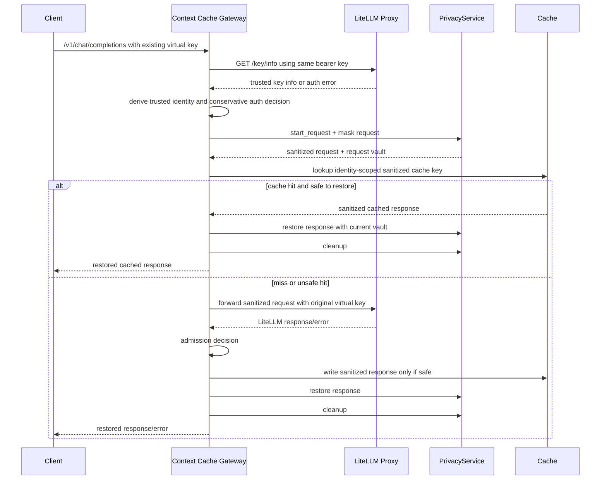

# Phase 0A Gateway Architecture

Date: 2026-11-09

## Goal

Introduce a future OpenAI-compatible Context Cache Gateway in front of LiteLLM while preserving existing virtual keys, classifier behavior, routing behavior, and privacy behavior.

Clients should eventually change only their base URL.

## Minimal API Surface

Initial endpoint:

- `POST /v1/chat/completions`

Initial constraints:

- Non-streaming only.
- Preserve request/response shape.
- Forward unsupported features directly to LiteLLM after authentication and privacy masking, or reject fail-closed when privacy policy requires.

## Lifecycle



## Authentication

Use `GET /key/info` self-validation:

- Gateway sends the client's bearer key to LiteLLM.
- Gateway accepts only HTTP 200 and `info.status == "active"`.
- Gateway never trusts request-body identity fields.
- Gateway never trusts arbitrary identity headers.
- Gateway does not copy LiteLLM key validation code.
- Gateway does not create a second virtual-key database.

## Trusted Identity

Gateway-internal structure:

```python
class GatewayIdentity:
    key_hash: str
    status: str
    user_id: str | None
    team_id: str | None
    organization_id: str | None
    project_id: str | None
    models: tuple[str, ...]
    allowed_routes: tuple[str, ...]
    permissions: dict
    object_permission: dict | None
```

Only populate fields returned by successful `GET /key/info`.

Fallback scope hierarchy:

```text
ORGANIZATION -> PROJECT -> TEAM -> USER -> KEY
```

Implementation:

- Use `organization_id` when present.
- Else `project_id`.
- Else `team_id`.
- Else `user_id`.
- Else top-level returned key hash.

If every higher-level identity field is absent, key-level isolation is mandatory.

## Authorization On Cache Hits

LiteLLM still performs full authorization on cache misses because the gateway forwards the original virtual key.

Cache hits need conservative checks:

- Route must be `/v1/chat/completions` and permitted by returned `allowed_routes` when that list is non-empty.
- Model must be directly allowed by returned `models` when that list is non-empty.
- If inherited access, access groups, wildcards, object permissions, or route groups are ambiguous, bypass cache and forward to LiteLLM.
- Do not serve cache hits for keys with `status != "active"`.

This preserves security at the cost of hit rate.

## Privacy

Gateway uses existing `PrivacyService` directly:

- Load the same `PRIVACY_POLICY_PATH`.
- Reject streaming if policy requires.
- Fail closed on masking or restoration failure.
- Use a gateway-generated request key.
- Always cleanup in `finally`.

## Cache Lookup And Admission

Cache key inputs:

- Privacy policy version.
- Trusted scope from the fallback hierarchy.
- Requested model alias.
- Normalized sanitized messages.
- Relevant generation parameters.
- Gateway/cache schema version.

Do not include raw PII. Do not include client-provided identity.

Initial admission rules:

- Store sanitized responses only.
- Do not store restored responses.
- Do not admit responses containing restorable PII placeholders until portable restoration is redesigned.
- Do not admit streaming responses in the first release.
- Do not admit tool-call responses until tool-call restoration and deterministic safety rules are tested.

## Forwarding To LiteLLM

On cache miss or unsafe hit:

- Forward sanitized request to LiteLLM.
- Forward the original virtual key in `Authorization`.
- Preserve the existing OpenAI-compatible request contract.
- Let LiteLLM enforce classifier, routing, model restrictions, route restrictions, budgets, logging, and provider invocation.

## Initial Feature Handling

- Streaming: reject or bypass cache according to existing privacy policy; current privacy policy rejects streaming.
- Tool calls: bypass cache initially unless no restorable placeholders are present and restoration tests cover tool arguments.
- Model restrictions: cache-hit only when conservatively proven; otherwise miss-forward.
- Usage metadata: cache hits should return explicit cache-hit usage policy, likely copied from cached response only if acceptable; otherwise bypass in first implementation.
- Errors: do not cache authentication, authorization, privacy, or provider errors in the first implementation.

## Failure Handling

- LiteLLM auth unavailable: fail closed; do not serve cache.
- Invalid/revoked/expired key: return LiteLLM auth failure semantics; do not serve cache.
- Missing tenant identity: fall back to key hash; if key hash absent, fail closed.
- Cache unavailable: after successful auth and privacy masking, bypass cache and forward to LiteLLM.
- Privacy initialization failure: fail closed.
- Masking failure: fail closed.
- Restoration failure: fail closed and do not write cache.
- Client cancellation: cleanup request vault in `finally`; abort upstream/cache work when possible.
- Gateway restart: in-flight vaults are lost; no cache hit should depend on in-memory vault state.
